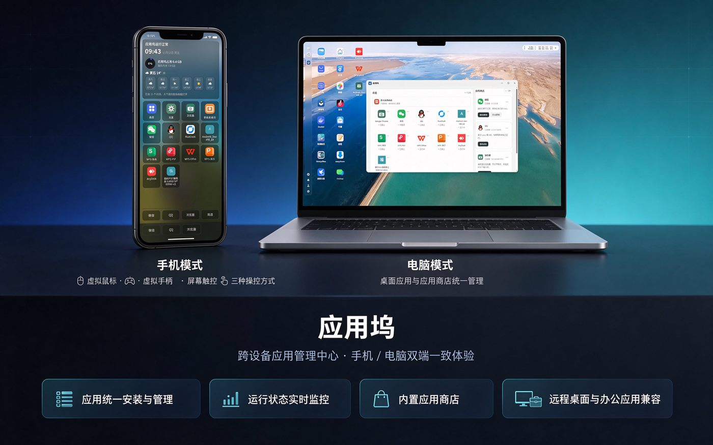
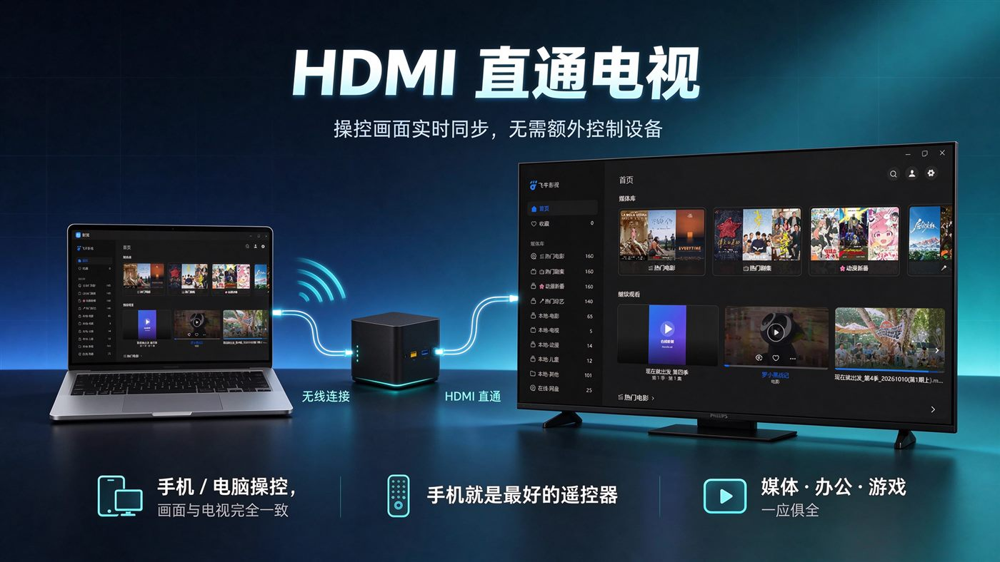

# 应用坞 · AppDock for fnOS

**让飞牛拥有一键安装并运行 `deb` / `exe` / `AppImage` / `apk` 的能力。**

原生 FPK 应用，**不依赖 Docker**。不开应用的时候软件本体几乎不占内存。



<p align="center">
  
  
  
</p>

模块化设计，拆成三件：

| 包 | 格式 | 体积 | 管什么 |
|---|---|---|---|
| 应用坞本体 | `.fpk` | 497 MB | 应用坞本身，能装 `deb` / `AppImage` / `fpk` |
| 安卓运行环境 | `.ypk` | 980 MB | Waydroid，跑 `apk` 靠它 |
| Windows 运行环境 | `.ypk` | 280 MB | Wine，跑 `exe` 靠它 |

**顺序很简单**：先装本体，之后在文件管理器里双击对应的运行环境包，就会自动安装并启用。装了什么环境，就多支持什么格式——没装安卓环境双击 apk 会提示先装环境，没装 Windows 环境双击 exe 同理。

**本仓库为闭源发布：只提供安装包与使用文档，不提供源代码。** 详见 [LICENSE](LICENSE)。

---

## 安装

1. 「应用中心 → 手动安装」选 `应用坞-1.0.0.fpk`
2. 要跑 Windows 程序：文件管理器里**双击** `应用坞-Win运行环境.ypk`
3. 要跑安卓程序：文件管理器里**双击** `应用坞-安卓运行环境.ypk`

双击 `.ypk` 会弹确认框，确认后走完整安装流程。也可以进 **设置 → 兼容性** 手动「从本地添加」。

### 系统要求

- fnOS ≥ 1.2.0401
- 依赖 `nodejs_v24`（应用中心自动装）
- 安卓环境需要内核带 `binder_linux`
- 仅 x86_64。ARM 设备暂不支持（安卓环境没有转译层）

---

## 主要功能

**1. 文件管理器双击即装即跑**
双击 `deb` / `exe` / `AppImage` / `apk`，直接安装并运行——`exe` 走 Wine、`apk` 走 Waydroid。
> 实验功能，某些软件可能不稳定。跑不起来会给出中文原因，不会静默失败。

**2. 已装软件生成为飞牛原生 FPK**
装好的软件可打包成原生 fpk，在飞牛窗口里以原生模式打开。依赖应用坞（没装应用坞就打不开）。

**3. 软件连同运行环境一起打包**
连运行时一起塞进 fpk，别人没装应用坞也能直接跑，代价是包很大。

**4. 内置内网穿透**
盒子里的程序分享链接给他人，不需要自己有公网也能访问。

**5. 多窗口、多软件共存**
每个软件独立窗口，可单独生成分享链接（需创建飞牛原生桌面图标）。

**6. 手机专用适配**
触控模式、虚拟鼠标模式、虚拟游戏手柄模式，支持手柄按键映射。

**7. 与主系统隔离**
软件跑在隔离环境里，随意折腾不会污染或搞坏飞牛主系统。

**8. 通过 WebDAV 直接读主系统文件**
在飞牛文件管理器里添加 WebDAV 即可访问应用坞内的文件。

**9. 全程一键**
安装一键、卸载一键（连实例和数据一起清），傻瓜式操作。

**10. 直通显示器**
软件能开直通显示器，手机控制和电视画面同步——手机就是电视遥控器，不用给电视接键盘鼠标。

**11. 安卓能力**
硬件支持时一键装安卓系统直接跑安卓应用；不支持也没关系，内置安卓手机投屏，局域网内有安卓手机就能远程控制，也能双击 apk 自动装到局域网手机上。

**12. 其他**
飞牛终端里直接控制宿主机、fpk 软件双击装上飞牛、把 Docker 应用生成为原生桌面图标、AI 终端，以及一堆自己发掘的功能。

---

## 校验和

```
f279733dbcc48af4ecde84628078a17dc8e6a3c84885bd7cddbdaa547b25ebe4  应用坞-1.0.0.fpk          522114218 字节
37d75a4bfc634fdfeb3149ae13b7c69a200ac489350a112af8f8a21ba6b54738  应用坞-Win运行环境.ypk     301117130 字节
dfa8b81c34db633d2c0e3b8ba5b56a88c987843b780b0f9b89ec047abdead616  应用坞-安卓运行环境.ypk   1037293646 字节
```

```bash
sha256sum -c SHA256SUMS.txt
```

---

## 一键部署（下载 + 校验）

不需要图形界面时：

```bash
git clone https://github.com/canyueljf/softbox.git
cd softbox
docker compose up
```

它会把三个包下载到 `./downloads`、逐个校验 SHA-256，然后提示你去应用中心完成安装。只校验已有文件：

```bash
docker compose run --rm softbox-installer sh /install.sh --verify-only
```

产物目录可改：`DOWNLOADS=/vol2/1000/其它/下载 docker compose up`

> 应用坞本身是 fnOS 平台应用，容器里跑不起来（安卓环境依赖宿主内核 `binder_linux`）。Docker 在这里只承担安装器。

---

## 常见问题

**双击 exe 或 apk 没反应？**
对应运行环境没装。双击 `应用坞-Win运行环境.ypk` 或 `应用坞-安卓运行环境.ypk`。

**双击 exe 提示「缺少 XXX.DLL」？**
程序真的缺库。去 设置 → 兼容性 → Windows 运行环境 装运行库，或把 DLL 放进程序目录。

**安卓环境一直停在「正在启动」？**
```bash
lsmod | grep binder
```
没有就得先让宿主机加载 `binder_linux`，部分飞牛机型镜像默认没编进去。

**ARM 设备能用吗？**
暂时不能，安卓环境只做了 x86_64。

**装完显示旧版本号？**
覆盖安装后重启一次：`appcenter-cli stop softbox` → `appcenter-cli start softbox`。

---

## 许可

闭源、专有许可。仅允许个人在自己的设备上安装使用；**禁止再分发、禁止反编译、禁止提取代码用于其他项目**。完整条款见 [LICENSE](LICENSE)。

---

维护者：残月 · 913775068@qq.com
